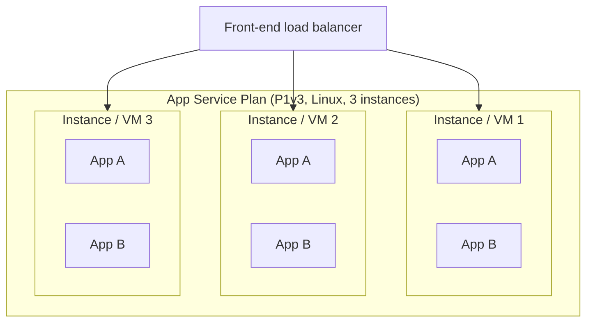
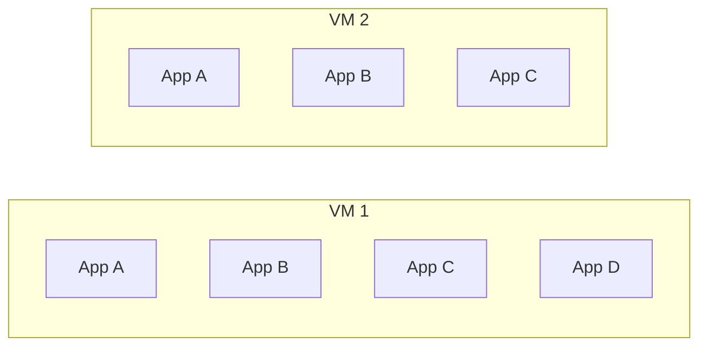

# Azure App Service Plan - Wiki Note

## 1. What is an App Service Plan (ASP)?

An **App Service Plan** is the compute allocation (the "server farm") that hosts one or more Azure App Service apps (Web Apps, API Apps, Function Apps, Logic Apps Standard, Mobile Apps). It defines:

| Property | Meaning |
|---|---|
| **Region** | Datacenter where the VMs run |
| **OS** | Windows or Linux (cannot mix in the same plan) |
| **SKU / Pricing tier** | Free, Shared, Basic, Standard, Premium v2/v3/v4, Isolated v2 |
| **VM size** | CPU / RAM / storage per instance (e.g. P1v3 = 2 vCPU, 8 GB) |
| **Instance count** | Number of VMs (workers) running the plan |

> Mental model: **The plan is the VM fleet. The app is a workload that runs on that fleet.** You pay for the plan, not per app.



---

## 2. Key Terminology

| Term | Definition |
|---|---|
| **Plan** | Logical container for compute resources (`Microsoft.Web/serverfarms`) |
| **App** | Site hosted in the plan (`Microsoft.Web/sites`) |
| **Instance / Worker** | One VM allocated to the plan. Scale-out increases this number |
| **Scale up** | Change SKU (more CPU/RAM per instance) |
| **Scale out** | Increase instance count (more VMs) |
| **Slot** | Deployment slot (staging, etc.); runs on the **same** plan instances and shares their resources |
| **Container** | Docker container running the app code (Linux/Windows container apps) |
| **Front end** | Shared Azure load balancer/reverse proxy that routes requests to instances |

---

## 3. Instance Count vs Container Count

### 3.1 Core rule

**Instance count (VMs) and container count are NOT the same thing and are not configured together.**

- **Instance count** = number of VMs in the plan (set on the plan; manual or autoscale).
- **Container count** = how many containers are running; App Service does **not let you set this directly**.

### 3.2 Default behavior: 1 container per app per instance

For each app on the plan, App Service starts **one container (Linux) or one worker process (Windows) per instance**.

```
Containers on plan = (number of apps) x (number of instances)   [per app, per slot that is running]
```

Example: Plan has 3 instances, hosts App A and App B.

| | Instance 1 | Instance 2 | Instance 3 | Total |
|---|---|---|---|---|
| App A | 1 | 1 | 1 | 3 |
| App B | 1 | 1 | 1 | 3 |
| **Total containers** | 2 | 2 | 2 | **6** |

So for a **single app** on the plan: **instance count == container count** (1:1).
With **multiple apps** (or running slots): **container count > instance count**.

### 3.3 Cases where they differ

| Scenario | Instance count | Containers | Why |
|---|---|---|---|
| 1 app, 3 instances | 3 | 3 | 1 container per instance |
| 2 apps, 3 instances | 3 | 6 | Each app gets a container on each instance |
| 1 app + 1 staging slot (running), 2 instances | 2 | 4 | Slots are separate running copies on the same VMs |
| App limited with **per-app scaling** to 2 of 5 instances | 5 | 2 for that app | App only runs on a subset |
| Multi-container (Docker Compose, **retired/legacy preview**) | N | N x containers in compose | Sidecar-style multiple containers per instance |
| **Sidecar** containers (Linux, new feature) | N | N x (1 main + k sidecars) | Main app container plus sidecars per instance |
| App stopped | N | 0 for that app | Plan still bills for the instances |
| Plan with 0 apps | N | 0 | Still billed (except Free/Shared tiers) |
| Windows (non-container) | N | 0 containers; N worker processes (w3wp) | No Docker container, IIS worker process |

### 3.3.1 Example: 7 containers on 2 VMs, but never 7 replicas of one app

Plan: 2 instances (VM1, VM2). Total containers can still reach 7, but only as a mix of different apps.

| App | Instances it runs on | Containers |
|---|---|---|
| App A | VM1, VM2 | 2 |
| App B | VM1, VM2 | 2 |
| App C | VM1, VM2 | 2 |
| App D (per-app scaling = 1) | VM1 only | 1 |
| **Total** | 2 VMs | **7** |



Conclusion:

- Replicas of any single app = number of instances it runs on (max 2 here). Not 7.
- 7 is the sum across different apps; every container shares the 2 VMs' CPU and RAM.
- Sidecars and running slots also add to the total, but are not replicas of the app.
- To get 7 replicas of one app: scale out the plan to 7 instances, or use Azure Container Apps / AKS, where replica count is independent of VM count.

### 3.4 Things that are internal / not controllable

- You cannot say "run 5 containers of my app on 1 instance" through App Service. Increase throughput by **scaling out** (more instances) or **scaling up**.
- Inside one container, you may run multiple processes (e.g. gunicorn workers, Node cluster, PM2). These are processes, not App Service containers.
- Platform may also run additional system containers (e.g. Kudu/SCM, log/diagnostic agents). They are not counted in your app's instance count and don't count against your plan's instance count.

### 3.5 Per-app scaling

Available on Standard and above. Lets individual apps use only a subset of the plan's instances.

- Plan: 10 instances.
- App A: per-app scale = 3 -> runs on only 3 of the 10.
- Useful for high-density hosting, so one app doesn't consume all instances.
- Instance count of plan stays 10; containers of App A = 3.

### 3.6 Always On / Instance warm-up

- **Always On**: keeps the app container loaded (Basic and above); without it the container may be unloaded after ~20 min idle (container count for that app can effectively drop to 0 and cold start follows).
- **Health check**: unhealthy instances are removed from load balancer rotation and may be replaced.

---

## 4. Can an App Service Exist Without a Container?

**Yes.** "Container" is only one of the ways to run an app. App Service supports three deployment models:

| Model | Container? | Description |
|---|---|---|
| **Code (built-in runtime)** | Linux: runs in a **platform-managed container** (Microsoft built-in images) you never see. Windows: IIS worker process, **no Docker container** | You deploy code (zip, Git, GitHub Actions); platform supplies runtime (.NET, Node, Python, Java, PHP) |
| **Custom container** | Yes, your own image | Image from ACR, Docker Hub, or private registry; Linux or Windows containers |
| **Static content / other** | Windows: served by IIS | Simple static sites |

So:

- **Windows code app**: No Docker container at all. IIS + worker process on the VM.
- **Linux code app**: Technically runs inside a Microsoft-provided container, but you do not build or manage it.
- **Custom container**: You supply the image; you own the OS-level dependencies.
- **Even with zero running apps**: the **plan can exist with no app** and still bills (Basic+).

### 4.1 Does a plan need an app?

No. An App Service Plan is a standalone resource and can exist empty. Billing continues for provisioned instances (except Free tier).

### 4.2 Does an app need a plan?

Yes, always. Every App Service app must be assigned to a plan. Exception in practice: **Functions Consumption plan** (a different plan type, `Dynamic`, still a `serverfarms` resource but not a dedicated VM plan).

---

## 5. Plan Types and Their Behavior

| Tier | Dedicated VM | Scale out max (approx.) | Slots | Autoscale | Notes |
|---|---|---|---|---|---|
| **Free (F1)** | No (shared) | 1 | 0 | No | CPU quota, dev/test, no custom SLA |
| **Shared (D1)** | No (shared) | 1 | 0 | No | Windows only, CPU quota |
| **Basic (B1-B3)** | Yes | 3 | 0 | No (manual) | Dev/test, Always On supported |
| **Standard (S1-S3)** | Yes | 10 | 5 | Yes | Production entry level |
| **Premium v2/v3/v4** | Yes | 30 | 20 | Yes | Better perf, VNet integration, zone redundancy |
| **Isolated v2 (ASE v3)** | Yes, dedicated environment | 100 | 20 | Yes | Single-tenant, network isolation |

> Limits change over time; verify against the official Azure docs.

Related plan variants:

- **Consumption (Functions)**: serverless, scales to zero, billed per execution.
- **Flex Consumption (Functions)**: per-instance concurrency, scales to zero, VNet support.
- **Elastic Premium (EP1-EP3)**: pre-warmed instances, VNet, no cold start.
- **Workflow Standard (WS1-WS3)**: Logic Apps Standard.

---

## 6. Scaling

### 6.1 Scale up vs Scale out

| | Scale up (vertical) | Scale out (horizontal) |
|---|---|---|
| What changes | SKU / VM size | Instance count |
| Effect on containers | Same count, bigger each | More containers (1 per app per instance) |
| Downtime | Usually brief restart | None |
| Where | Plan | Plan |

### 6.2 Autoscale

- Rule-based (CPU %, memory %, HTTP queue length, schedule) or **automatic scaling** (Premium v2/v3, platform-managed with pre-warmed instances).
- Autoscale acts on **plan instance count**, never on container count directly.
- The plan's autoscale applies to **all apps** in it; they scale together (unless per-app scaling).

### 6.3 Scaling implications

- All apps on a plan share the plan's CPU/RAM. A noisy app can starve others.
- Scale-out multiplies memory footprint for each app on every instance; check RAM per instance = sum of app footprints.
- Stateless design is required: instances are not sticky by default (ARR affinity cookie can be enabled, but avoid it).

---

## 7. Resource Sharing and Isolation

| Shared by all apps on the plan | Isolated per app |
|---|---|
| VM CPU, RAM, disk | App settings / connection strings |
| Instance count / scaling rules | Custom domains / TLS bindings |
| Region, OS, SKU | Managed identity |
| Plan-level networking (VNet integration is per plan/subnet) | Deployment credentials, slots |

Guidelines:

- Group **related apps with similar lifecycle/scale needs** in the same plan.
- Put **noisy or critical apps in their own plan**.
- A common rule: don't overpack. Monitor plan CPU/memory.
- Apps in different **regions, OS (Windows vs Linux)**, or **resource groups** need different plans. A plan can be moved only within the same region, resource group and OS constraints (moves between plans allowed when same region and same OS/SKU family; check docs).

---

## 8. Containers on App Service in Detail

### 8.1 Linux

- All Linux apps run in containers (built-in image or custom).
- **Custom container**: image pulled from registry; port set via `WEBSITES_PORT`; storage via `WEBSITES_ENABLE_APP_SERVICE_STORAGE`.
- **Sidecar containers** (GA on Linux): main container + sidecars (e.g. OpenTelemetry collector, Redis, agents). Sidecars share the network namespace with the main container (localhost) and run on every instance.
- Multi-container via Docker Compose / Kubernetes YAML: legacy; use sidecars instead.

### 8.2 Windows

- Code apps: IIS, no Docker.
- Windows containers: supported on Premium v3/v4 and Isolated v2 only (Hyper-V isolation).

### 8.3 What happens during scale-out

1. Plan adds a new VM (instance).
2. Platform pulls the image / loads the code on the new instance for every app (or only per-app-scaled apps).
3. Health check / warm-up completes, then instance is added to load balancer.

### 8.4 What happens on restart/deploy

- Container for the app is restarted on each instance, sequentially or concurrently depending on deployment method.
- With **slots**, a warm-up then **swap** avoids cold start.

---

## 9. Billing

- Billed **per plan instance, per second (or hour)**, regardless of how many apps/containers run.
- 1 app or 20 apps on the same plan = same price (until resources run out).
- Scale-out of 3 instances = 3x price.
- Stopped apps still incur charges as long as the plan has instances (Basic and above).
- To stop billing: delete the plan, or scale to Free.
- Reserved Instances / Savings Plans available for Premium v3 and Isolated v2.

---

## 10. Networking Summary

| Feature | Plan-level or app-level |
|---|---|
| VNet integration (outbound) | App, using a delegated subnet; one subnet per plan |
| Private endpoint (inbound) | App |
| Access restrictions | App |
| Hybrid Connections | App (limits per plan) |
| Outbound IPs | Plan-level (shared by all apps in the plan scale unit) |

---

## 11. Common Questions (FAQ)

**Q: If I set instance count to 3, do I get 3 containers?**
For one app: yes, 3 containers (1 per instance). For N apps on the plan: 3 x N containers.

**Q: Can I run 2 containers of the same app on one instance?**
Not through App Service scaling. Use more instances, or run multiple processes in one container, or use sidecars for different purposes (not replicas).

**Q: Can I run an App Service without Docker?**
Yes. Use code deployment with a built-in runtime. On Windows it's IIS; on Linux the platform uses its own managed container transparently.

**Q: Can a plan exist without any app?**
Yes, and it still costs money (Basic+).

**Q: Do slots add instances?**
No. Slots run on the same instances as the production slot and consume that plan's CPU/memory.

**Q: Does stopping an app reduce cost?**
No. Only reducing the plan instance count/SKU or deleting the plan does.

**Q: Why do I see more instances in metrics than I configured?**
Possibly due to scale-out events in progress, platform maintenance (instances replaced), or Premium v3 automatic scaling with pre-warmed instances.

**Q: Can I mix Windows and Linux apps in one plan?**
No. A plan is OS-specific.

**Q: When should I choose App Service over Container Apps / AKS?**

| Need | Choose |
|---|---|
| Simple web/API, PaaS, minimal ops | App Service |
| Microservices, scale to zero, KEDA, Dapr | Azure Container Apps |
| Full orchestration control, custom networking | AKS |
| Event-driven functions | Azure Functions |

---

## 12. Useful CLI Commands

```bash
# Create a plan (Linux, P1v3, 2 instances)
az appservice plan create -g <rg> -n <plan> --is-linux --sku P1V3 --number-of-workers 2

# Scale out (change instance count)
az appservice plan update -g <rg> -n <plan> --number-of-workers 4

# Scale up (change SKU)
az appservice plan update -g <rg> -n <plan> --sku P2V3

# Create a code web app on the plan
az webapp create -g <rg> -p <plan> -n <app> --runtime "NODE:20-lts"

# Create a custom container web app
az webapp create -g <rg> -p <plan> -n <app> --container-image-name <registry>/<image>:<tag>

# Enable per-app scaling on the plan
az appservice plan update -g <rg> -n <plan> --elastic-scale false --per-site-scaling true

# Set number of instances for one app (per-app scaling)
az webapp update -g <rg> -n <app> --set siteConfig.numberOfWorkers=2

# List apps in a plan
az webapp list --query "[?appServicePlanId=='<plan-resource-id>'].name" -o tsv

# Enable autoscale
az monitor autoscale create -g <rg> --resource <plan> --resource-type Microsoft.Web/serverfarms \
  --min-count 2 --max-count 6 --count 2
```

---

## 13. Best Practices

- Use **Standard or higher** for production; Premium v3/v4 for performance and zone redundancy.
- Keep **at least 2 instances** for availability (and zone redundancy with 3 where supported).
- Enable **Always On**, **Health check**, and **autoscale** rules.
- Use **deployment slots** for zero-downtime releases.
- Separate **noisy/critical** apps into their own plans.
- Monitor plan metrics: CPU percentage, memory percentage, HTTP queue length, disk queue length.
- Prefer **sidecars** over legacy multi-container.
- Keep apps stateless; store state in external services (Redis, SQL, Storage).
- Tag plans and apps for cost allocation.

---

## 14. Summary Cheat Sheet

| Question | Answer |
|---|---|
| Plan = ? | The VM fleet (compute) hosting apps |
| Instance = ? | One VM in the plan |
| Containers per app per instance | 1 (default) |
| Containers on plan | apps x instances (+ sidecars, + running slots) |
| Instance count == container count? | Only for a single app, single slot, no sidecars, no per-app scaling |
| App without container? | Yes: Windows code apps (IIS); Linux code apps use platform-managed container |
| Plan without app? | Yes, still billed |
| App without plan? | No |
| Mix Windows + Linux in a plan? | No |
| What you pay for | Plan instances x SKU, not apps |
| Autoscale acts on | Plan instance count |

## 15. References

- Azure App Service plans overview: https://learn.microsoft.com/azure/app-service/overview-hosting-plans
- Scale up an app: https://learn.microsoft.com/azure/app-service/manage-scale-up
- Scale out / autoscale: https://learn.microsoft.com/azure/azure-monitor/autoscale/autoscale-get-started
- Per-app scaling: https://learn.microsoft.com/azure/app-service/manage-scale-per-app
- Sidecar containers: https://learn.microsoft.com/azure/app-service/tutorial-custom-container-sidecar
- App Service limits: https://learn.microsoft.com/azure/azure-resource-manager/management/azure-subscription-service-limits#app-service-limits
